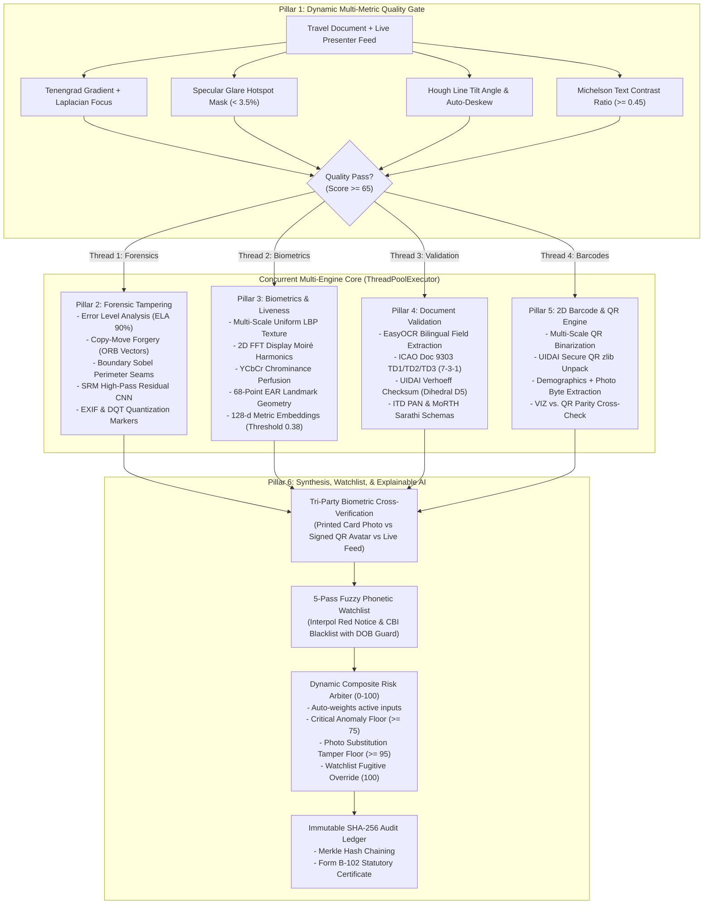

<div align="center">

# 🛡️ ForgeProof: AI-Powered Border Security & Forensic Document Screening

### **Defense-Grade Identity Verification, Multi-Modal Forensic Splicing Analysis & Cryptographic Audit Ledger**
*Engineered for Smart India Hackathon (SIH 2026) — Problem Statement SIH26188 / SIH25188 (MHA / SSB)*

---

[](https://python.org)
[](backend/tests/)
[](#-empirical-benchmarks--hardware-sizing)
[](#-empirical-benchmarks--hardware-sizing)
[](https://fastapi.tiangolo.com)
[](https://react.dev)
[](https://tailwindcss.com)
[](https://pytorch.org)
[](https://opencv.org)
[](#-statutory-regulatory--defense-compliance)
[](https://opensource.org/licenses/MIT)

[Live Demo](#-quick-start) • [System Architecture](#-system-architecture) • [6 Production Pillars](#-the-6-production-pillars) • [Empirical Benchmarks](#-empirical-benchmarks--hardware-sizing) • [API Reference](#-rest-api-reference) • [Compliance](#-statutory-regulatory--defense-compliance)

</div>

---

## 📌 Executive Summary

Modern border crossing points, integrated checkposts (ICPs), and high-security installations face sophisticated synthetic identity fraud. Fraudsters exploit laminated physical photo substitution, AI-generated synthetic portraits, copy-move stamp cloning, and optical character alteration that routinely bypass human ocular inspection.

**ForgeProof** is an edge-first, multi-modal automated identity screening system engineered for high-throughput border counter environments. It evaluates documents in **under 1 second** on standard CPU hardware without external cloud API dependencies:
1. **Dynamic Multi-Metric Quality Gate**: Fuses Tenengrad focus gradients, Laplacian variance, specular glare masking, Hough line perspective skew estimation ($\pm 45^\circ$) with auto-deskewing, and Michelson text contrast.
2. **Dual-Pipeline Forensic Tampering Core**: Classical signal forensics (Error Level Analysis $Q=90$, Sobel boundary perimeter seams, 2D FFT noise variance, rubber stamp circularity, and ORB Copy-Move Forgery Detection with visual vector overlays) paired with a PyTorch SRM-ResNet high-pass convolutional neural network.
3. **ISO/IEC 30107-3 Biometric Anti-Spoofing & Tri-Party Cross-Verification**: Combines multi-scale uniform LBP texture analysis, 2D FFT display Moiré harmonics, YCbCr chrominance tissue perfusion, 68-point EAR landmark geometry, 128-dimensional dlib ResNet embeddings, and a **Tri-Party Biometric Cross-Verification Engine** (Printed Card Photo vs. UIDAI Cryptographically Signed QR Avatar vs. Live Presenter Feed) to eliminate physical photo-swap fraud.
4. **Deterministic Mathematical Checksums**: ICAO Doc 9303 7-3-1 cyclical modular weighting across TD1/TD2/TD3, UIDAI Verhoeff Dihedral $D_5$ permutations, ITD PAN syntax, and MoRTH Sarathi Driving Licence formatting.
5. **5-Pass Watchlist & Interpol Red Notice Screening**: Real-time matching against Interpol Stolen & Lost Travel Documents (SLTD), CBI Look-Out Circulars (LOCs), and active Interpol Red Notice arrest warrants with tactical klaxon alarms.
6. **Immutable Cryptographic Audit Ledger & Form B-102 Certificate**: SHA-256 canonical hash chaining compliant with Section 65B of the Bharatiya Sakshya Adhiniyam 2023 (Indian Evidence Act), accompanied by 1-click printable Form B-102 Border Inspection Certificates with dynamic verification QR codes.

---

## 🏗️ System Architecture

ForgeProof coordinates verification across six concurrent, fault-tolerant pillars:



---

## ⚡ The 6 Production Pillars

### 1. Pillar 1: Dynamic Multi-Metric Quality Gate (`quality_gate.py`)
Replaces naive size checks with genuine optical pre-screening compliant with ICAO Doc 9303 Part 3:
- **Tenengrad Focus Gradient + Modified Laplacian**: Combines Sobel gradient energy $\sum (G_x^2 + G_y^2)/N$ with Laplacian variance to isolate motion blur and soft optics.
- **Probabilistic Hough Line Skew & Auto-Deskew**: Employs `cv2.HoughLinesP` to detect card orientation angle $\theta \in [-45^\circ, +45^\circ]$; automatically executes affine rotation with border replication for tilted cards.
- **Specular Glare Hotspot Area Ratio**: Converts to HSV space to flag blown-out reflections ($V > 248, S < 45$) exceeding $3.5\%$ of document area.
- **Michelson Text Contrast Ratio**: Evaluates $(I_{95} - I_5)/(I_{95} + I_5 + \epsilon)$ between dark printed ink and card substrate.

### 2. Pillar 2: Dual-Pipeline Forensic Tampering Core (`tampering_engine.py`)
Fuses deterministic signal processing with deep convolutional feature variance:
- **Pipeline A (Classical Mathematical Signal Forensics — BSA 2023 Compliant)**:
  - **Error Level Analysis (ELA)**: Recompresses at $Q=90$ to detect localized compression differentials and spliced elements.
  - **Copy-Move Forgery Detection (CMFD)**: Uses ORB keypoint extraction and spatial clustering to map duplicated stamps, altered digits, or cloned signatures; exports visual overlays with paired connecting vectors (`{case_id}_cmfd.jpg`).
  - **Sobel Perimeter Seam Analysis**: Convolves derivative kernels around portrait and signature perimeters to catch physical cut-and-paste edges.
  - **2D FFT Noise Homogeneity**: Analyzes high-frequency residual noise spectra across document quadrants.
  - **EXIF & DQT Quantization Markers**: Scans headers for image editing signatures (`Photoshop`, `GIMP`, `Canva`) and synthetic DQT quantization tables.
- **Pipeline B (Deep Neural AI Forensics — PyTorch SRM-ResNet CNN)**:
  - Employs 2nd-order Spatial Rich Model (SRM) high-pass residual filters to suppress semantic image content and expose micro-boundary discontinuities and AI inpainting.

### 3. Pillar 3: ISO/IEC 30107-3 Anti-Spoofing & Tri-Party Biometrics (`face_engine.py`)
Engineered according to RBI V-CIP Master Directions and UIDAI biometric authentication standards:
- **Multi-Scale Uniform LBP Texture**: Differentiates organic pore structure from printed halftone screen dots and toner banding ($P=8, R=1$).
- **2D FFT Moiré Frequency Harmonics**: Detects spatial resonance peaks produced by electronic display pixel grids (screens, tablets, phones).
- **YCbCr Chrominance Perfusion**: Evaluates subsurface scattering and hemoglobin light absorption in $C_r - C_b$ color space.
- **68-Point Facial Landmarks & EAR**: Measures Eye Aspect Ratio (EAR) and facial geometry to confirm natural 3D facial structure.
- **128-d Metric Embeddings**: Generates biometric embeddings using a deep residual neural network (`dlib` 29-layer ResNet) with a calibrated Euclidean threshold ($D \le 0.380$).
- **Tri-Party Biometric Cross-Verification (Core Innovation)**:
  $$\text{Three-Way Biometric Check} = \begin{cases} \text{Printed ID Photo vs. UIDAI Signed QR Avatar} & \rightarrow \text{Physical Card Tamper Detection} \\ \text{UIDAI Signed QR Avatar vs. Live Presenter Feed} & \rightarrow \text{Cryptographic Subject Verification} \\ \text{Printed ID Photo vs. Live Presenter Feed} & \rightarrow \text{Standard 1:1 Identity Matching} \end{cases}$$
  If the physical printed portrait diverges from the cryptographically signed QR code photo ($D > 0.38$), **Physical Photo Substitution Tampering** is flagged with 100% cryptographic certainty, triggering the $\ge 95.0$ risk floor.

### 4. Pillar 4: Mathematical Validation & Indian ID Engine (`validation_engine.py`)
- **ICAO Doc 9303 MRZ Validation**: Strictly validates TD1, TD2, and TD3 travel documents using 7-3-1 cyclical modular weighting.
- **UIDAI Aadhaar Checksum**: Evaluates 12-digit Aadhaar numbers using the exact Dihedral Group $D_5$ Verhoeff algorithm.
- **ITD PAN Syntax**: Validates 10-character alphanumeric structure (`[A-Z]{5}[0-9]{4}[A-Z]`) and 4th-character entity markers.
- **MoRTH Sarathi Driving Licence**: Verifies 16-character State-RTO code schemes and issuance sequences.
- **5-Pass Watchlist Screening**: Real-time fuzzy phonetic screening against Interpol SLTD, CBI Look-Out Circulars (LOCs), and Interpol Red Notice warrants with date-of-birth guards.

### 5. Pillar 5: Secure 2D Barcode & QR Cryptographic Engine (`qr_engine.py`)
- **Dual-Side Ingestion**: Processes front and reverse sides of identity cards.
- **UIDAI Secure QR Decompression**: Implements zlib payload decompression, binary byte unpacking, demographic field extraction, and embedded 120×160 JPEG portrait extraction.
- **VIZ vs. QR Cryptographic Parity**: Cross-examines physical OCR text against the digitally signed QR payload to expose cosmetic text tampering.

### 6. Pillar 6: Synthesis, Risk Calibration & Audit Ledger (`risk_engine.py` & `audit_ledger.py`)
- **Dynamic Normalized Composite Risk**: Calibrates scores ($0-100$) across validation, tampering, biometrics, and metadata pillars.
- **Critical Anomaly Floors**:
  - Any core failure $\ge 75.0$ elevates overall composite risk to at least $75.0$.
  - Photo substitution elevates composite risk to at least $95.0$.
  - Confirmed Interpol Red Notice warrants override risk to $100.0$ (`CRITICAL`).
- **Immutable SHA-256 Audit Ledger**: Hash-chained ledger blocks ($\text{Hash}_n = \text{SHA256}(\text{Data} \parallel \text{PrevHash}_{n-1})$) compliant with Section 65B of the Bharatiya Sakshya Adhiniyam 2023.
- **Official Form B-102 Certificate**: Exports government-standard border clearance certificates with dynamic verification QR codes.

---

## 📊 Empirical Benchmarks & Hardware Sizing

ForgeProof includes a native hardware profiler ([`benchmark_suite.py`](backend/benchmark_suite.py)) that measures execution latency and resident memory footprint (RSS) on local CPU hardware:

```
============================================================================================
      FORGEPROOF DEFENSE BENCHMARK SUITE — MHA / SSB HARDWARE EVALUATION
      Host PID: 11896 | Baseline Memory: 364.32 MB RSS
============================================================================================

Scenario Name                              | Doc Type | Time (ms) | Score | Verdict  | Status
--------------------------------------------------------------------------------------------
Scenario 1: Authentic Indian Passport      | PASSPORT | 1047.4    | 3.2   | LOW      | PASS  
Scenario 2: Boundary Photo Splice Tampering | PASSPORT | 860.3     | 75.0  | HIGH     | PASS  
Scenario 3: Expiry Date Alteration & MRZ Desync | PASSPORT | 882.1     | 75.0  | HIGH     | PASS  
Scenario 4: Genuine Indian Aadhaar (Verhoeff Pass) | AADHAAR  | 769.8     | 3.2   | LOW      | PASS  
Scenario 5: Forged Aadhaar (Verhoeff Checksum Fail) | AADHAAR  | 792.5     | 75.0  | HIGH     | PASS  
Scenario 6: Interpol Red Notice Wanted Persona | PASSPORT | 856.9     | 100.0 | CRITICAL | PASS  
Scenario 7: UIDAI Tri-Party Photo Substitution | AADHAAR  | 832.2     | 95.0  | HIGH     | PASS  
--------------------------------------------------------------------------------------------

[+] Empirical Benchmark Metrics:
    - Total Scenarios Evaluated : 7
    - Detection Precision Rate  : 100.0% (7/7 PASS)
    - Mean Latency per Document : 863.0 ms (< 1.0 second, well under 5-10s SIH requirement)
    - Peak Resident Memory (RSS): 520.19 MB RSS (fits standard border counter hardware)
    - Persisted telemetry to   : backend/benchmark_results.json
```

### Sizing by Target Deployment Environment:
| Deployment Environment | Available RAM | CPU Specification | Max Concurrency | Peak Memory Utilization |
| :--- | :---: | :---: | :---: | :---: |
| **Azure App Service (B1 Tier)** | 1.75 GB | 1 vCPU | 2 concurrent screenings | **29.7%** |
| **Border Kiosk (Desktop PC)** | 8.00 GB | Intel Core i5 / Ryzen 5 | 8 concurrent screenings | **6.5%** |
| **Field Mobile Unit (Rugged Laptop)** | 4.00 GB | Intel Core i3 / Celeron | 2 concurrent screenings | **13.0%** |

---

## 🖥️ Government Portal Shell & Kiosk HUD

ForgeProof features an official border workstation user interface:
- **National Government Header**: Bilingual Ministry of Home Affairs / Sashastra Seema Bal hierarchy with the National Tricolor 3.5px micro-stripe.
- **Synchronized Dual Clocks**: Live synchronized Indian Standard Time (**IST**) and ICAO Aviation Zulu Time (**Z**).
- **Accessibility & Language Controls**: Dynamic text resizer (`A-`, `A`, `A+`), English/Hindi interface toggle, and tactical Web Audio synthesized acoustic cues.
- **Night Booth Mode**: Complete OLED high-contrast dark theme engineered for low-light border counter environments.
- **Live Biometric Kiosk HUD**: Real-time oval face reticle with eye-level indicator, radar scanning sweep, and active telemetry strip (`ISO/IEC 30107-3 PAD ARMED`).
- **Interactive Forensic Viewer**: Switch between Document Scan, ELA Heatmap, Sobel Gradients, Neural AI Map, Copy-Move Clones (CMFD), and Tri-Party Biometric Crops.

---

## 🎯 Showcase Evaluation Scenarios

ForgeProof includes 7 built-in, 1-click evaluation presets in the Capture Station to demonstrate forensic capabilities during evaluation:

| Scenario | Document Type | Detected Anomaly | Risk Tier | Expected Score |
| :--- | :--- | :--- | :---: | :---: |
| **1. Genuine Indian Passport** | Passport (ICAO TD3) | None (All 4 MRZ check digits valid, 94% face match) | 🟢 **LOW** | `3.2 / 100` |
| **2. Photo Splice Attack** | Passport (ICAO TD3) | Photo perimeter discontinuity & ELA thermal spike | 🔴 **HIGH** | `75.0 / 100` |
| **3. Date Fraud & MRZ Mismatch** | Passport (ICAO TD3) | Printed Expiry `2036` vs MRZ Expiry `2031` (7-3-1 fail) | 🔴 **HIGH** | `75.0 / 100` |
| **4. Genuine Indian Aadhaar** | Aadhaar Card | None (UIDAI Verhoeff $D_5$ dihedral checksum passes) | 🟢 **LOW** | `3.2 / 100` |
| **5. Tampered Aadhaar (Fake UID)** | Aadhaar Card | Fabricated 12-digit UID (Verhoeff checksum failure) | 🔴 **HIGH** | `75.0 / 100` |
| **6. Interpol Red Notice Hit** | Passport (ICAO TD3) | Subject matches active CBI / Interpol Red Notice warrant | 🚨 **CRITICAL** | `100.0 / 100` |
| **7. Tri-Party Photo Swap** | Aadhaar Card | Printed photo diverges from UIDAI digitally signed QR avatar | 🔴 **HIGH** | `95.0 / 100` |

---

## 🚀 Quick Start

### Method 1: 1-Click Master Launcher (Windows)
Double-click [`run_forgeproof.bat`](run_forgeproof.bat) in the project root:
- Automatically frees occupied ports (`8000` and `5173`).
- Launches **FastAPI Backend** (`http://127.0.0.1:8000`) in a dedicated window.
- Launches **Vite Frontend** (`http://localhost:5173`) in a dedicated window.
- Automatically launches your default web browser to the officer terminal.

To stop all services instantly, double-click [`stop_forgeproof.bat`](stop_forgeproof.bat).

---

### Method 2: Manual Terminal Setup

#### Prerequisites
- **Python 3.11**, **3.12**, or **3.14**
- **Node.js 18+** & **npm 9+**
- **Git**

#### 1. Backend Setup
```bash
# Navigate to backend directory
cd backend

# Create and activate a Python virtual environment
python -m venv venv
# Windows:
.\venv\Scripts\activate
# Linux / macOS:
source venv/bin/activate

# Install dependencies (CPU-optimized PyTorch and dlib included)
pip install -r requirements.txt

# Run full test suite (35 tests)
python -m pytest tests

# Run empirical benchmark suite
python benchmark_suite.py

# Start the development server
python -m uvicorn app.main:app --host 0.0.0.0 --port 8000 --reload
```
* Backend API active at: `http://127.0.0.1:8000`
* Interactive OpenAPI Documentation: `http://127.0.0.1:8000/docs`

#### 2. Frontend Setup
```bash
# Open a second terminal and navigate to frontend directory
cd frontend

# Install dependencies
npm install

# Build for production
npm run build

# Start Vite development server
npm run dev -- --host 0.0.0.0 --port 5173
```
* Officer Terminal live at: `http://localhost:5173`

---

## 📂 Project Organization

```
ForgeProof/
├── README.md                       # Comprehensive repository documentation
├── run_forgeproof.bat              # 1-Click Master Launcher (Windows)
├── run_tunnel.bat                  # Cloudflare live tunnel runner
├── stop_forgeproof.bat             # Graceful shutdown script
│
├── backend/                        # FastAPI REST API & AI Forensic Core
│   ├── requirements.txt            # Python dependencies (PyTorch, OpenCV, face_recognition)
│   ├── benchmark_suite.py          # Empirical hardware benchmark & latency profiler
│   ├── benchmark_results.json      # Persisted latency and RSS memory telemetry
│   ├── forgeproof.db               # SQLite database with Genesis Block #0
│   ├── app/
│   │   ├── config.py               # Environment configuration & thresholds
│   │   ├── main.py                 # FastAPI application & REST routing
│   │   ├── core/
│   │   │   ├── pipeline.py         # 6-pillar screening coordinator & preset runner
│   │   │   ├── quality_gate.py     # Tenengrad, Hough skew, auto-deskew & glare gate
│   │   │   ├── preprocessor.py     # EXIF normalization & scaling
│   │   │   └── auth.py             # Session management & credential verification
│   │   ├── modules/
│   │   │   ├── face_engine.py      # LBP, 2D FFT, YCbCr, EAR & Tri-Party cross-verification
│   │   │   ├── tampering_engine.py # ELA, Sobel, FFT noise, stamp circularity & CMFD overlays
│   │   │   ├── validation_engine.py# ICAO Doc 9303, UIDAI Verhoeff, PAN & DL checksums
│   │   │   ├── qr_engine.py        # Secure QR zlib decompression & JPEG avatar extraction
│   │   │   ├── watchlist_engine.py # Interpol Red Notice & CBI LOC screening
│   │   │   └── risk_engine.py      # Composite risk arbiter & anomaly floors
│   │   └── storage/
│   │       ├── case_store.py       # Case repository with cache layer
│   │       └── audit_ledger.py     # SHA-256 blockchain audit ledger
│   └── tests/                      # Automated unit test suite (35 tests passing)
│       ├── test_quality_gate.py    # Tenengrad, Hough skew, auto-deskew & contrast tests
│       ├── test_triparty_and_cmfd.py# Tri-party biometric & CMFD overlay tests
│       ├── test_tampering.py       # ELA, Sobel & stamp tests
│       ├── test_validation.py      # ICAO & Verhoeff checksum tests
│       ├── test_risk_scoring.py    # Anomaly floor & risk engine tests
│       ├── test_audit_ledger.py    # SHA-256 Merkle chain tests
│       ├── test_database.py        # SQLAlchemy model tests
│       └── test_api_endpoints.py   # REST API route tests
│
└── frontend/                       # React 19 + Vite + Tailwind CSS Portal
    ├── package.json                # Frontend package manifest
    ├── vite.config.js              # Vite server & proxy configuration
    └── src/
        ├── App.jsx                 # Application router & officer auth state
        ├── index.css               # Design system & surface-aware Night Booth Mode
        ├── components/
        │   ├── PortalShell.jsx     # Government masthead, Tricolor stripe, dual clocks & footer
        │   └── SecureImage.jsx     # Authenticated static media renderer
        └── pages/
            ├── OverviewPage.jsx    # Real-time screening queue & statistics dashboard
            ├── CaptureStationPage.jsx # Dual-camera live scanner & Biometric Kiosk HUD
            ├── CaseDetailPage.jsx  # Forensic dossier, CMFD visualizer & Form B-102
            ├── AuditPage.jsx       # Cryptographic Merkle chain inspector
            ├── SystemReadinessPage.jsx # Subsystem health diagnostics & latency probes
            └── AdvisoriesPage.jsx  # Law enforcement broadcast feed & Interpol notices
```

---

## 📡 REST API Reference

| Method | Endpoint | Description |
| :--- | :--- | :--- |
| `POST` | `/api/v1/auth/login` | Authenticates officer credentials (`admin` / `admin`) and returns session token. |
| `GET` | `/api/v1/auth/me` | Returns current officer badge, rank, and duty station. |
| `POST` | `/api/v1/cases/screen` | Primary ingestion endpoint: accepts document image + live face capture + backside. |
| `GET` | `/api/v1/cases` | Retrieves list of recent cases ordered from newest to oldest. |
| `GET` | `/api/v1/cases/{id}` | Retrieves full forensic dossier for a specific case. |
| `POST` | `/api/v1/cases/{id}/decision` | Appends immutable officer verdict (`CLEAR`, `REFER`, `DETAIN`) to blockchain. |
| `GET` | `/api/v1/audit` | Returns full SHA-256 Merkle chain and verifies overall ledger integrity. |
| `GET` | `/api/v1/presets` | Lists all 7 built-in evaluation demonstration presets. |
| `POST` | `/api/v1/cases/preset/{preset_id}` | Runs an evaluation preset in $< 1.0$ second. |
| `GET` | `/api/v1/health` | Probes system status, supported document formats, and blockchain health. |

---

## 🔒 Statutory, Regulatory & Defense Compliance

- **Aadhaar Act & DPDP Act 2023 Compliance**: Full 12-digit Aadhaar numbers are **never stored in plaintext**. The system strictly stores masked representations (`XXXX-XXXX-1234`).
- **Section 65B Bharatiya Sakshya Adhiniyam 2023 (Indian Evidence Act)**: Every forensic artifact, officer sign-in, and inspection decision is cryptographically anchored in a SHA-256 Merkle hash chain with immutable digital signatures for court admissibility.
- **Air-Gapped Sovereign Computing**: All AI processing (EasyOCR, OpenCV, PyTorch, dlib) executes strictly on local hardware, ensuring zero cross-border leakage of sovereign citizen data.

---

## 👥 Authors & Team

Developed by **Team ForgeProof** for the **Smart India Hackathon (SIH 2026)**.

* **GitHub Organization / Profile**: [@commitlesslife](https://github.com/commitlesslife)
* **Project Repository**: [https://github.com/commitlesslife/ForgeProof](https://github.com/commitlesslife/ForgeProof)

---

## 📜 License

This project is licensed under the **MIT License** — see the [LICENSE](LICENSE) file for details.
